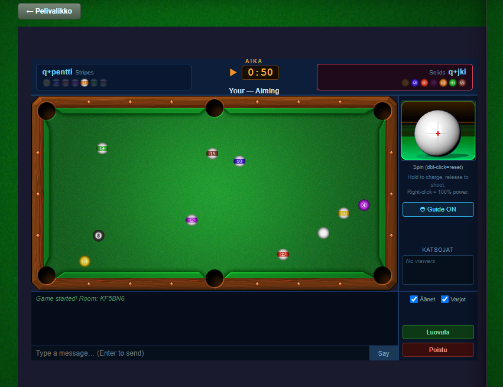
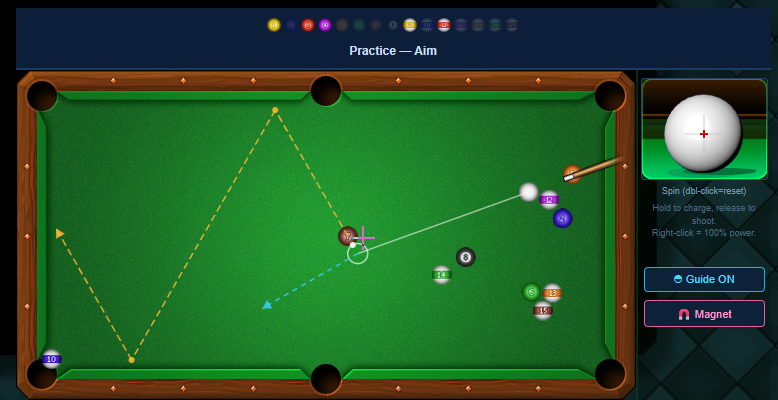

playforia
=========

Faithful web ports of the original Playforia (Aapeli) games. Currently: **Pool & Snooker**
(8-ball, 9-ball, rotation, count, free practice, snooker) with a physics engine ported from
the original Java client, an aim-assist "cheat" system, a token/badge progression layer, and
WebSocket multiplayer (lobby, challenges, deterministic-lockstep play, spectating).

Game play images:

### 3D view & realistic physics

The game now opens in a **three.js 3D view** (switch with **🎥 3D view / ▦ 2D view** in the side panel,
or `?view=2d` / `?view=3d` in the URL):

- **Cue camera (default):** a player's-eye view: low behind the cue ball, looking down the cue line
  (it leans over the rail when the cue ball is near a cushion). After the strike the camera steps
  back to show the whole table. While aiming, a line runs to the exact contact point, with a ghost
  ball and short lines showing where the object ball and the cue ball will go.
  - drag: aim (hold **Shift** for fine aim; vertical drag raises/lowers your eye)
  - hold **Space** or the **right mouse button** (or the *Hold to shoot* button) to charge, release to shoot
  - **[ / ]**: cue elevation · **← →**: fine aim · **mouse wheel**: step closer/back · **V**: switch view
  - near a cushion the cue rises automatically to clear the rail (almost vertical for a centre hit on a
    frozen ball); press **[** to keep it lower by striking higher on the ball (topspin)
- **Top camera:** point-and-click like the 2D board. It is also used automatically for ball-in-hand placement.

The 3D table has its own pocket system (round holes behind angled jaws, sized like a real table),
and the realistic physics uses exactly the same geometry, so what you see is what the balls bounce off
and drop into. The Guide and assist lines are the engine's own, projected onto the cloth.

With **Physics: Real**, local games are played on a regulation-size table: the cloth area stays the
same and the balls shrink to real proportions (a 9 ft pool table is ~44 × 22 ball widths; 12 ft snooker ~68 × 34).
The original Playforia proportions are closer to a 6 ft bar table, and Classic and online games keep them.

**⚙ Physics: Real** (default for local games) uses the
[pooltool model](https://ekiefl.github.io/2020/04/24/pooltool-theory/): balls slide, roll and spin
with sliding/rolling/spinning friction; the cue strike transfers top/back/side spin (draw, follow,
stun and english work); and cushions use Han's 2005 impulse model. **Classic** is the original
Playforia engine. **Online games always use Classic**, because both players' clients must simulate
every shot identically.

Test the current development:
https://jooansk.github.io/playforia/

If you wish to share your thoughts and wish to play online or you have complaints about functionality then contact in discord channel playforia-pool